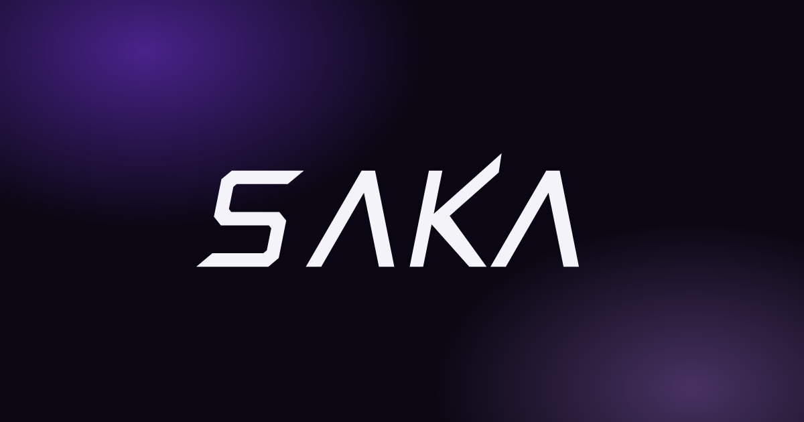
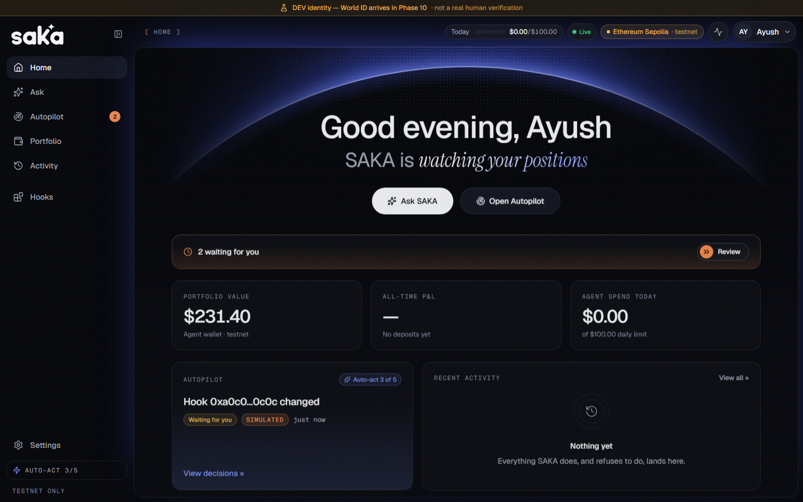
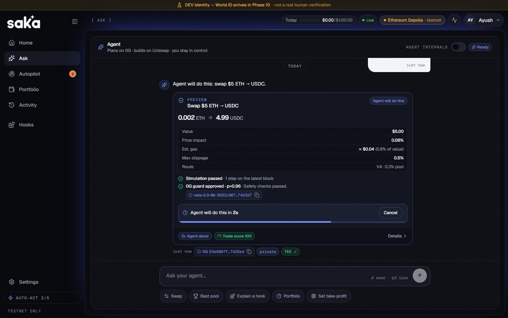
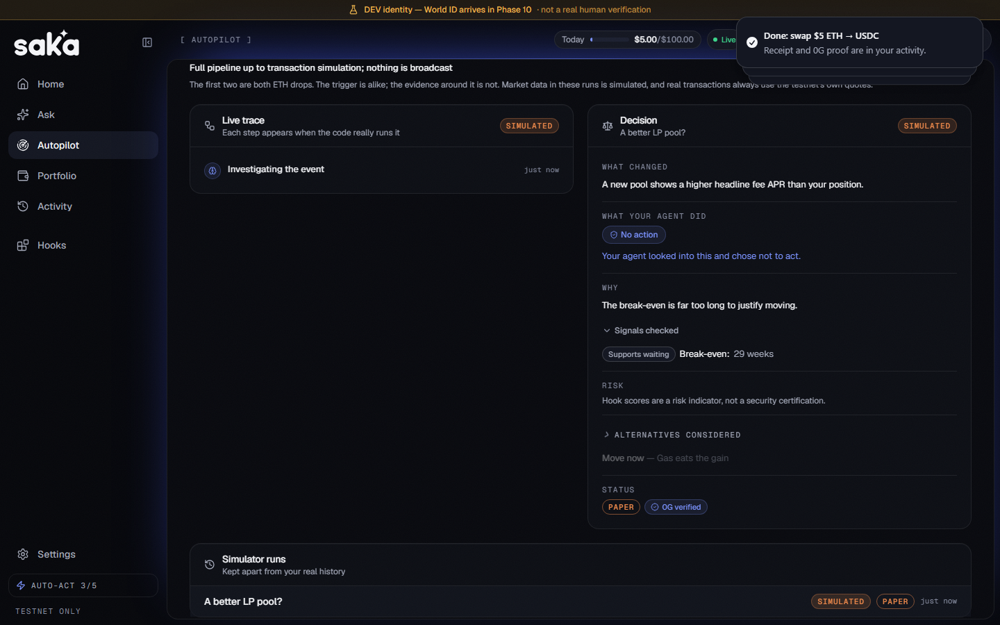
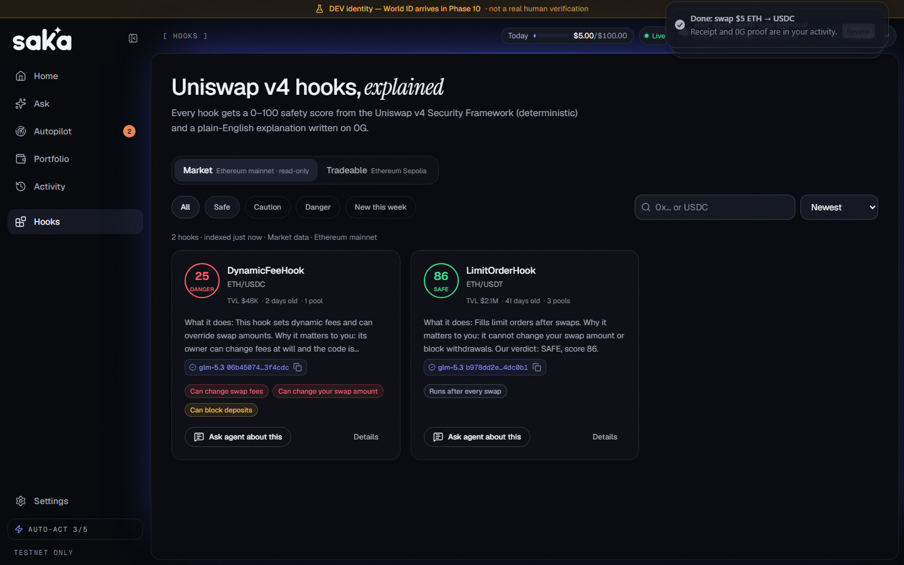

<p align="center"></p>

# SAKA

**Your own AI DeFi agent, with a verifiable reason for every move.** Sign in, get an agent wallet,
and ask in plain English: "Swap $20 ETH to USDC", "Put $100 into ETH/USDC", "Is this hook safe?".
SAKA plans with verified AI models on **0G**, builds transactions through our own **Uniswap** MCP
server, and puts each one through a safety pipeline. Small, safe actions run alone. Anything bigger
waits for you.

> Without 0G the agent can't think, can't double-check its own trades, and there's no tamper-proof
> record of why it moved your money.

Built for ETHGlobal Mumbai (Nov 5–7, 2026). Execution happens on **one testnet** only. Ethereum
mainnet is used read-only for market data.

| Home                                               | A trade, before it runs                                            |
| -------------------------------------------------- | ------------------------------------------------------------------ |
|  |  |

| Market Event Simulator                                                 | Hook safety                                          |
| ---------------------------------------------------------------------- | ---------------------------------------------------- |
|  |  |

Screenshots use mock data. More are in [`docs/ui-revamp/screenshots/after/`](docs/ui-revamp/screenshots/after/).

## What it does

- **Ask:** tell the agent what you want. You see the amounts, fees and safety checks, then a
  3-second countdown with Cancel. Over your limits, it asks first.
- **Autopilot:** the agent comes to you. Nine detectors watch each funded wallet and propose
  actions with Yes / Change / No, in the app and on Telegram.
- **Market Event Simulator:** you choose when a market event happens. The 0G model decides what to
  do about it, and "no action" counts as a real decision.
- **Hooks:** Uniswap v4 hooks explained in plain words, each with a deterministic 0–100 safety score.
- **Activity:** everything the agent did and refused to do, with on-chain and 0G proofs.

## Status

| Area                                                              | State                                          |
| ----------------------------------------------------------------- | ---------------------------------------------- |
| Uniswap agent MCP server (16 tools, unsigned-only)                | ✅ done                                        |
| Privy agent wallet, onboarding, balance watcher, portfolio        | ✅ done                                        |
| 0G planner, guard (Vela), explainer, request IDs                  | ✅ done                                        |
| Safety scores, simulation, policy, approvals, execution, 0G log   | ✅ done                                        |
| Hooks, LP positions, rules (take-profit, stop-loss, DCA, chained) | ✅ done                                        |
| Autopilot detectors, Telegram alerts, Market Event Simulator      | ✅ done                                        |
| SAKA interface                                                    | ✅ done                                        |
| World ID sign-in and step-up approvals                            | 🚧 not yet: a labelled dev identity runs today |

SAKA was first called Warden, so package names (`@warden/*`), the database and older docs still use
that name.

Build notes: [`PHASE_REPORT_01.md`](PHASE_REPORT_01.md) to [`PHASE_REPORT_08.md`](PHASE_REPORT_08.md),
[`docs/ARCHITECTURE.md`](docs/ARCHITECTURE.md), and the interface work in
[`docs/ui-revamp/`](docs/ui-revamp/final-report.md).

## Quick start (local)

Requirements: Node.js 22 (`.nvmrc`), pnpm 9 (`corepack enable`), Docker.

```bash
cp .env.example .env            # then set ENCRYPTION_KEY and ADMIN_TOKEN (see comments)
pnpm install
docker compose up -d            # Postgres 16 (warden + warden_test) and Redis 7
pnpm db:migrate                 # apply Prisma migrations
pnpm dev                        # web :5173 · api :3001 · worker · Uniswap MCP :3002
```

Open <http://localhost:5173>, enter a name (for example `alice`), and choose **Continue (dev
identity)**. Onboarding creates your agent's Privy server wallet (needs `PRIVY_APP_ID` and
`PRIVY_APP_SECRET`), lets you pick a risk profile, and waits for a testnet ETH deposit. The worker
detects it within about 15 s (needs the MCP server and `MCP_AUTH_TOKEN`), then opens Home. Live
activity, behind the pulse button in the top bar, shows **"Funded: … ETH"**.

Generate secrets:

```bash
openssl rand -base64 32   # ENCRYPTION_KEY
openssl rand -hex 32      # ADMIN_TOKEN
```

## Try it

1. **Ask → "Swap $5 ETH to USDC".** Watch the preview, the countdown and the receipt with its 0G proof.
2. **Ask → "Swap $60 ETH to USDC".** It goes over the limit, so the agent asks you first.
3. **Ask → "Swap $500 ETH to USDC".** It refuses and explains why.
4. **Autopilot → Simulator** (needs `ENABLE_DEMO_SIMULATOR=true`). Run all three scenarios. The first
   two are both ETH drops with different evidence, so the agent should reach different conclusions.
5. **Turn on Agent internals** to see the live trace beside the chat.
6. **Details** on any card opens the whole story: timeline, checks, policy, calls and the 0G log.

## How a decision is made

Every money-moving intent goes through one deterministic pipeline
([`agent/pipeline.ts`](apps/api/src/modules/agent/pipeline.ts)):

1. **Prepare** ([`agent/preparer.ts`](apps/api/src/modules/agent/preparer.ts)): intent → our MCP
   build tools (`build_swap`, `build_transfer`, `compare_pools` → `build_lp_position`,
   `build_lp_exit`, `build_rebalance`, `plan_trigger`), USD value at risk from the mainnet
   reference price, profile slippage, `planHash` = sha256 of canonical JSON.
2. **Score:** deterministic trade score 0–100 with a `{rule, penalty, evidence}` breakdown
   ([`safety/tradeScore.ts`](apps/api/src/modules/safety/tradeScore.ts)), `check_token` for every
   token, `score_hook` for hook pools (cached 1 h, [`safety/hookGate.ts`](apps/api/src/modules/safety/hookGate.ts)).
3. **Simulate:** `eth_call` of every built step from the agent wallet
   ([`safety/simulate.ts`](apps/api/src/modules/safety/simulate.ts)). Steps after an approval and
   Permit2-signed steps are simulated again right before broadcast.
4. **Guard:** 0G Vela 2.0, which **fails closed** ("Safety check unavailable").
5. **Policy:** pure `decide()` → AUTO / STEP_UP / REFUSE / ASK
   ([`policy/engine.ts`](apps/api/src/modules/policy/engine.ts)). Reasons carry value and limit.
6. **Approve:** AUTO shows a preview with a 3-second countdown and Cancel. STEP_UP shows an approval
   bound to user, plan, `planHash` and amount, with a 5-minute expiry and single use. Today this is
   a DEV approval, available only with dev providers. REFUSE shows a red card with reasons.
7. **Execute** ([`execution/executor.ts`](apps/api/src/modules/execution/executor.ts)): BullMQ, one
   plan at a time per user, approval marked USED in the same transaction, today's spend re-checked,
   **re-quote within 1%** or "Price moved", fresh calldata, Permit2 signed by Privy only now, Privy
   broadcast with idempotency key `${planId}:${step}`, receipt (timeout → check by hash, never
   re-broadcast), lots, LP positions and known recipients updated.
8. **Decision log** ([`decisionlog/`](apps/api/src/modules/decisionlog)): canonical JSON of the whole
   decision (0G request IDs, scores, simulation, guard, policy, approval, tx hashes; no personal data,
   no signatures) uploaded to **0G Storage** with `MemData`. The root hash is on the card and in
   `GET /decision-logs/:planId`. Refused, denied, expired and failed plans are logged too.

Routes: `GET /plans/:id`, `POST /plans/:id/cancel`, `POST /plans/:id/repreview`,
`GET /approvals/:id`, `POST /approvals/:id/deny`, `POST /approvals/:id/dev-approve` (dev only),
`GET /decision-logs/:planId`.

## Sponsor integrations

- **0G:** verified/private inference with request IDs on every reply, plus a decision log on
  0G Storage.
- **Uniswap:** our own MCP server in `packages/uniswap-agent-mcp`, also published as a `uniswap-ai`
  plugin in our fork: <https://github.com/Ayush-Bansal08/uniswap-ai/tree/feat/uniswap-agent-mcp/packages/plugins/uniswap-agent-mcp>.
  Developer feedback is in [`FEEDBACK.md`](FEEDBACK.md).
- **Privy:** agent wallets are app-controlled server wallets with a per-wallet policy that only
  allows Uniswap contracts, Permit2 and allowlisted tokens. Every Privy call is in
  [`apps/api/src/modules/wallet/privy.ts`](apps/api/src/modules/wallet/privy.ts).
- **World:** World ID Agent Pass for sign-in and step-up approvals is planned, not built yet.

## AI layer (0G)

Everything the agent thinks runs on the 0G Router with provenance on every call:

| Role             | Model (env)                    | Trust mode                       | Endpoint                                |
| ---------------- | ------------------------------ | -------------------------------- | --------------------------------------- |
| Planner          | `ZG_MODEL_PLANNER` (GLM-5.3)   | `private`                        | `/v1/chat/completions` + MCP read tools |
| Planner fallback | `ZG_MODEL_PLANNER_FALLBACK`    | `ZG_PLANNER_FALLBACK_TRUST_MODE` | `/v1/chat/completions`                  |
| Guard            | `ZG_MODEL_GUARD` (Vela 2.0)    | `private`                        | `/v1/decisions` (fails closed)          |
| Explainer        | `ZG_MODEL_EXPLAINER` (0GM-1.0) | `private`                        | `/v1/chat/completions`                  |

Each call sends `X-0G-Provider-Trust-Mode`, our own `X-Client-Request-Id` and `verify_tee: true`,
and stores the router's `X-Request-ID` and `x_0g_trace` (provider, `tee_verified`, billing) in an
`Inference` row. The same request ID appears as a "0G" chip in live activity and on the agent's
reply. Code: [`ai0g/client.ts`](apps/api/src/modules/ai0g/client.ts),
[`agent/planner.ts`](apps/api/src/modules/agent/planner.ts),
[`safety/guard.ts`](apps/api/src/modules/safety/guard.ts),
[`ai0g/explainer.ts`](apps/api/src/modules/ai0g/explainer.ts).

- `pnpm smoke:zg`: one live call per model, printing `X-Request-ID`, trust mode and `tee_verified`.
- `pnpm eval:planner`: 35 live planner cases → [`docs/eval-planner.md`](docs/eval-planner.md)
  (latest: 32/35, 91.4%).
- A key restricted to `private` routing must set `ZG_PLANNER_FALLBACK_TRUST_MODE=private`. The router
  answers `403 trust_mode_mismatch` to `verified` on such keys.

## Hooks, liquidity and rules

- **Hooks (`/hooks`):** real mainnet hooks, and testnet hooks you can trade through, each with a
  deterministic 0–100 score from the v4 Security Framework, permissions in plain words ("Can change
  your swap amount"), change history and a 0G-written explanation with its request ID.
- **Liquidity:** "Put $10 into ETH/USDC" picks the pool and a range that fits your risk profile.
  Positions show a live range bar, value, fees and P&L, with Rebalance and Exit.
- **Rules:** take-profit, stop-loss, DCA and chained rules. Each fire goes through every safety
  check again, and over-limit actions ask you first.

Demo control (admin only; it changes only _when_ rules fire, never trade amounts):

```powershell
curl -X POST http://localhost:3001/admin/price-override -H "x-admin-token: $env:ADMIN_TOKEN" `
  -H "content-type: application/json" -d '{"symbol":"ETH","priceUsd":"2300","ttlSec":180}'
```

## Autopilot and Telegram

Every 60 s the worker checks each funded wallet with nine detectors
(`apps/api/src/modules/modeb/detectors`): dip, profit, idle USDC, better pool, out of range, new
hook, hook changed, big move and the 08:00 morning brief. Anything that moves money runs through the
same pipeline as a chat request. Safe actions under your limits run alone with a receipt. The rest
wait in Autopilot and on Telegram with Yes / Change / No, and "Yes" re-quotes before anything runs.

- **Telegram:** set `TELEGRAM_BOT_TOKEN` and `TELEGRAM_BOT_USERNAME`, then Settings → Connect
  Telegram. `pnpm dev` long-polls; production uses `API_URL/telegram/webhook` with
  `TELEGRAM_WEBHOOK_SECRET`. The bot only sends alerts: free text gets one fixed line.
- **Market Event Simulator:** set `ENABLE_DEMO_SIMULATOR=true` on the API and open Autopilot →
  Simulator. Three scenarios feed simulated market conditions to the 0G planner, which decides. The
  action then runs the normal pipeline on the testnet (Demo) or stops after simulation (Paper).
- **Demo:** `POST /admin/simulate-event` with `{ userId, detector, overrides? }` and
  `POST /admin/run-brief` with `{ userId }`, both with the `x-admin-token` header.
- **Sepolia:** set `UNISWAP_BLOCKED_POOLS` (see `.env.example`) so each trade takes the cleanest
  route.
- **Price drops buy:** `BIG_MOVE` down and `DIP` buy your dip amount, once a day between them, under
  your limits and the "Dip buys" switch. Autopilot then reports what was bought or sold, and why.

## Identity

Until World ID lands, sign-in uses a clearly labelled **DEV identity provider** behind the
`IdentityProvider` interface: the same name always signs in as the same human, which models "one
human = one agent". An amber banner stays visible while it is active. The API **refuses to start**
if dev providers are configured with `NODE_ENV=production`.

## Scripts

| Command                | What it does                                                                 |
| ---------------------- | ---------------------------------------------------------------------------- |
| `pnpm dev`             | web + api + worker in parallel (Turborepo)                                   |
| `pnpm lint`            | ESLint (typescript-eslint, react-hooks)                                      |
| `pnpm typecheck`       | `tsc --noEmit` in every package                                              |
| `pnpm test`            | Vitest: shared, api (integration with Postgres/Redis), web                   |
| `pnpm build`           | Build shared, api and web                                                    |
| `pnpm db:migrate`      | `prisma migrate deploy` with the root `.env`                                 |
| `pnpm db:migrate:dev`  | Create a new migration after schema changes                                  |
| `pnpm db:studio`       | Prisma Studio                                                                |
| `pnpm db:seed`         | Connectivity check (creates no user data)                                    |
| `pnpm format`          | Prettier                                                                     |
| `pnpm smoke:mcp`       | LIVE: MCP quotes (testnet + mainnet), new hooks, hook score                  |
| `pnpm smoke:privy`     | LIVE: Privy agent wallet + policy, then a 0 ETH self-transfer (prints hash)  |
| `pnpm check:sources`   | LIVE: health of every market-data source + which one serves each capability  |
| `pnpm smoke:zg`        | LIVE: one call per 0G model (X-Request-ID, trust mode, tee_verified)         |
| `pnpm smoke:zgstorage` | LIVE: upload a decision log to 0G Storage, download it by root hash, compare |

```powershell
pnpm --filter @warden/web test       # component tests (Vitest + Testing Library)
pnpm --filter @warden/web test:e2e   # Playwright against a stateful mock API
```

API tests use the separate `warden_test` database and Redis DB 1. Override them with
`TEST_DATABASE_URL` and `TEST_REDIS_URL`.

## Repository layout

```
apps/api                    Fastify API + BullMQ worker + Telegram bot
apps/web                    React 19 + Vite 6 + Tailwind 4 web app (Vercel)
packages/shared             Zod schemas and types shared by api, web and mcp
packages/uniswap-agent-mcp  Uniswap agent MCP server (standalone; see its README)
docs/                       Architecture, UI revamp, vendor docs
deploy/railway/             Railway service configs
FEEDBACK.md                 Uniswap developer feedback
```

## License

[MIT](LICENSE)
